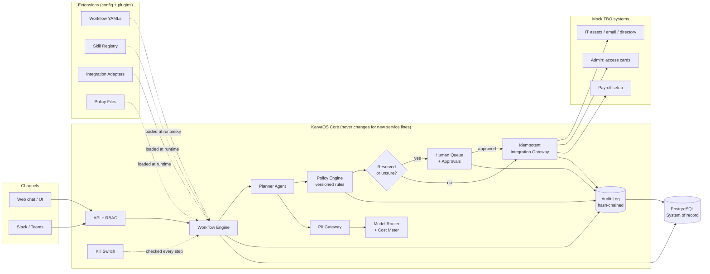

# KaryaOS: Architecture, Governance & Extension Model

## 1. Architecture Overview



**Governed action flow (7 steps, 1 decision):**
HR event → agent plans → policy check → *reserved or unsure?* → (yes) named human approves or rejects → agent executes via system APIs → audit log (who, what, why).

## 2. Core vs. Extension Contract

| Add this… | Do this | Core change? |
|---|---|---|
| New service line (for example, Exit) | Add `extensions/workflows/exit.yaml` + policies | ❌ None |
| New agent skill | Drop a plugin in `extensions/skills/` with `manifest.yaml` | ❌ None |
| New integration | Add an adapter implementing `IntegrationAdapter` | ❌ None |
| New reserved decision | Edit `config/reserved_decisions.yaml` (or via HR UI) | ❌ None |
| New policy rule | Add a YAML rule plus tests | ❌ None |

### 2.1 Workflow definition (data, not code)

```yaml
# extensions/workflows/onboarding.yaml
id: onboarding
version: 3
trigger: employee.hired
inputs: [employee_id]
steps:
  - id: create_directory_account
    skill: directory.create_account
    mode: auto
  - id: provision_email
    skill: email.provision
    depends_on: [create_directory_account]
    mode: auto
  - id: allocate_laptop
    skill: assets.allocate_laptop
    mode: auto
    sla_minutes: 30
    on_failure: human_queue
  - id: issue_access_card
    skill: admin.issue_access_card
    mode: auto
    depends_on: [create_directory_account]
  - id: setup_payroll
    skill: payroll.setup_employee
    mode: auto
  - id: confirm_compensation
    skill: hr.confirm_compensation
    mode: approval            # forces a named human
    approver_role: hrbp
  - id: assign_buddy
    skill: manager.assign_buddy
    mode: auto
  - id: welcome_message
    skill: comms.send_welcome
    mode: auto
    llm: small
```

### 2.2 Skill manifest

```yaml
# extensions/skills/assets/manifest.yaml
name: assets.allocate_laptop
version: 1.2.0
type: integration            # integration | rules | llm
permissions_required: [asset:allocate]
idempotency: [employee_id, asset_type]
integration: it_assets
model: none                  # rule-based; no LLM
timeout_s: 20
retry: {max: 3, backoff: exponential}
```

### 2.3 Reserved decisions (HR-editable config)

```yaml
# config/reserved_decisions.yaml
version: 7
updated_by: hrbp.priya
reserved:
  - action: resignation.accept
    approver: [hr_head]
  - action: hiring.final_decision
    approver: [hiring_manager, hrbp]
  - action: compensation.change
    approver: [hrbp, finance_head]
  - action: disciplinary.any
    approver: [hr_head]
  - action: complaint.posh|grievance|whistleblower
    mode: route_only          # agent routes to the committee, never decides
  - action: payroll.run_signoff
    approver: [finance_head]
  - action: policy.exception
    approver: [hrbp]
minimum_set_locked: true      # UI cannot remove the baseline entries
```
Enforcement lives in the engine: **if the action matches the reserved list, the step cannot run in `auto` mode**. The approve endpoint rejects agent tokens (`principal_type=agent`).

### 2.4 Policy as a governed layer

```yaml
# extensions/policies/notice_period.yaml
id: notice_period
version: 4
effective_from: 2025-04-01
rules:
  - name: default_notice_days
    when: {grade: [L1, L2, L3]}
    then: {notice_days: 30}
  - name: senior_notice_days
    when: {grade: [L4, L5]}
    then: {notice_days: 90}
tests:
  - given: {grade: L2}
    expect: {notice_days: 30}
  - given: {grade: L5}
    expect: {notice_days: 90}
```
Rules are evaluated by code. The model never "remembers" statutory values. CI fails if a policy's tests fail. Each decision logs `policy_id@version`.

## 3. Data Model (system of record)

| Table | Key columns |
|---|---|
| `person` | id, legal_name, dob, contact (encrypted), purpose_tags |
| `candidate` | person_id, requisition_id, stage, rank_explanation (JSON), human_reviewed_by |
| `employee` | person_id, emp_code, status, manager_id, grade, org_unit, effective_from/to |
| `employment_event` | employee_id, type (hire, transfer, resignation, exit), effective_date, payload |
| `workflow_run` | id, workflow_id, version, subject_id, status, started_at, ended_at |
| `step_run` | run_id, step_id, mode, human_touch (bool), status, idempotency_key, attempts |
| `approval_request` | id, run_id, step_id, action, approver_person_id, decision, decided_at, reason |
| `human_queue_item` | id, run_id, reason (failure / low_conf / conflict), context_bundle (JSON) |
| `audit_log` | seq, ts, actor_type (human/agent/system), actor_id, action, inputs_ref, rule_or_prompt_version, model, reasoning, outcome, prev_hash, hash |
| `consent_record` | person_id, purpose, granted_at, withdrawn_at |
| `dsr_request` | person_id, type (access/correction/erasure), status |
| `model_call_meter` | step_run_id, model, tokens_in/out, cost_inr, pii_masked (bool) |
| `flag` | scope (agent/workflow/skill), name, paused, paused_by |

Effective-dated rows give a full hire→exit history. Postgres row-level security enforces role visibility.

## 4. Fail-Safe Design

| Failure | Behaviour |
|---|---|
| Integration 5xx/timeout | Retry with backoff using the **same idempotency key**; the gateway returns the stored result if the call already succeeded |
| Retries exhausted / circuit open | Create `human_queue_item` with context (step, inputs, last error, suggested action) |
| Agent confidence < threshold | Queue to a human; never guess |
| Data conflict (HRMS ≠ directory) | Queue; no write |
| Duplicate event delivery | Run keyed on `(workflow_id, subject_id, trigger_event_id)`; second creation is a no-op |
| Resume | Replay from the last successful step |

**Idempotent gateway sketch**
```python
def call(adapter, op, payload, key):
    rec = store.get(key)
    if rec and rec.status == "done":
        return rec.response          # no second laptop
    store.put(key, status="in_flight")
    resp = adapter.invoke(op, payload, idempotency_key=key)
    store.put(key, status="done", response=resp)
    return resp
```
Test: kill the process between `invoke` and `store.put`, retry, and assert that the mock asset API holds exactly one allocation (the adapter also forwards the key to the mock API).

## 5. PII & DPDP Handling

```
Employee data ──► PII Gateway ──► [mask/minimise] ──► Model
                      │                                 │
                      └── logs fields sent ◄────────────┘
```
| Data | Goes to model? | Treatment |
|---|---|---|
| Name, email, phone | No (replaced with `<PERSON_1>` tokens) | Presidio masking; re-hydrate after |
| Aadhaar, PAN, bank, UAN | **Never** | Blocked at the gateway |
| Role, grade, location, start date | Yes (minimal) | Needed for planning |
| Salary | No | Handled by rule code and the human approver |

- **Hosting statement:** small model self-hosted in-VPC (no data leaves); escalation model receives masked text only. Both are documented in the README.
- **Purpose limitation:** each field has `purpose_tags`; a skill declares the purposes it uses, and the gateway blocks mismatches.
- **Consent:** `consent_record` checked where processing is not covered by employment contract.
- **Retention:** `config/retention.yaml` (for example, candidate data 12 months, exited-employee data per statute); a scheduled job purges and audits.
- **Access / correction:** DSR workflow, an extension YAML itself.

## 6. Fair Hiring Guard (if the candidate flow is touched)
- Ranking = transparent weighted score (rules) with a per-factor breakdown stored in `rank_explanation`.
- The `reject` action is reserved: the agent can only *recommend*; a named recruiter confirms.
- Protected attributes are excluded from features, with a test asserting that.

## 7. Access Control
- Roles: `employee`, `manager`, `hrbp`, `hr_head`, `it_ops`, `admin_ops`, `finance`, `auditor`, `developer`.
- **Delegation rule:** the effective permissions of an agent run = `agent_skill_permissions ∩ acting_user_permissions`.
- Every chat action runs under the asking user's identity.

## 8. Kill Switch
`flag` table checked **before every step** (cached for ≤1 s, invalidated via Redis pub/sub). HR UI toggle pauses an agent, a skill or a whole workflow. Paused steps park in the human queue with the reason "paused by <name>".

## 9. Explainability Record (per agent action)
```json
{
  "action": "assets.allocate_laptop",
  "inputs_ref": "step_run:8841",
  "rule_or_prompt_version": "onboarding@3 / planner_prompt@12",
  "model": "qwen2.5-7b (or 'none: rule')",
  "reasoning": "Grade L2 + Bengaluru → standard laptop pool B",
  "policy_checks": ["asset_policy@2: pass"],
  "outcome": "allocated asset A-2291"
}
```