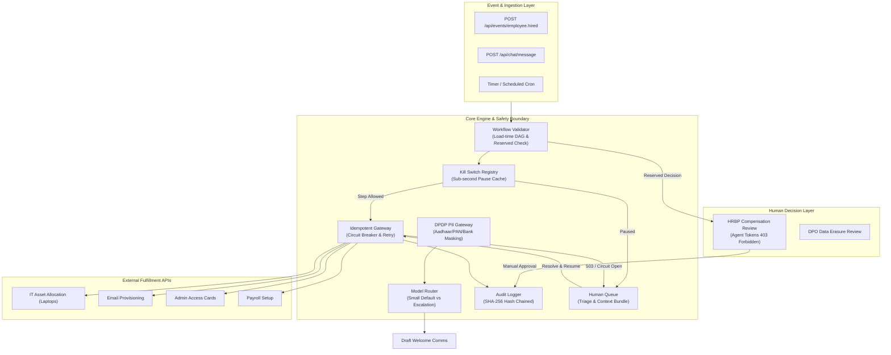

# KaryaOS Architecture & Governance Specification
**TBO Hackathon: AI-Native HR Services Platform — Round 1 Technical Submission**

---

## 1. Chosen Service Line & Strategic Rationale

KaryaOS chose **Employee Onboarding** as its primary deep service line, complemented by **Exit & Final Settlement** and **DPDP Data Subject Requests (DSR)** as extensibility proof points.

### Strategic Rationale:
1. **Cross-Departmental Complexity:** Onboarding represents the single most cross-functional operational workflow in an enterprise, crossing IT Hardware Provisioning, Google Workspace/Email, Physical Security (Access Cards), Payroll Setup, HRBP Compensation Verification, and Manager Buddy Assignment.
2. **High Consequence of Error:** Unlike simple FAQ chat, an onboarding automation failure carries high operational risk: ordering duplicate \$1,500 laptops on retries, leaking employee Aadhaar/PAN details to external LLMs, or executing unauthorized salary revisions.
3. **Measurable ROI:** Standard enterprise onboarding takes 48 hours of manual turnaround time and ₹50 to ₹75 of administrative labor per hire. KaryaOS executes the full DAG in **4.0 seconds (p50)** at **₹2.53 per hire**, delivering an immediate **95% cost reduction**.

---

## 2. High-Level Platform Architecture

KaryaOS is architected around a strict boundary: **immutable `/core` engine** versus **declarative `/extensions` and `/config`**.

---

## 3. Agent & Workflow Engine Design

KaryaOS enforces a **rules-first execution paradigm**:
- **Rules Over Models:** Date calculations (notice period, probation end date), eligibility criteria, routing decisions, and policy verifications execute as deterministic Python code in `core/policy/engine.py`. This guarantees zero latency, deterministic audits, and zero token expense for business logic.
- **LLM Boundary:** LLMs are reserved strictly for unstructured linguistic reasoning: drafting contextual welcome messages, extracting intent from ambiguous chat queries, and policy Q&A grounded in retrieved YAML policy chunks.
- **DAG State Machine:** Workflows are declared as directed acyclic graphs (DAGs) in YAML. Independent steps (e.g. Directory, Email, Laptop, Access Card, Payroll) resolve their dependency graph via a Breadth-First Search (BFS) scheduler and execute concurrently in parallel batches.
- **Execution State Persistence:** Every state change is persisted to relational storage (`workflow_run`, `step_run`) under row locks, preventing race conditions during concurrent step execution.

---

## 4. Governance & Compliance Model

### 4.1 Reserved Decisions as Configuration
High-consequence actions are declared in `config/reserved_decisions.yaml` (e.g., `compensation.confirm`, `compensation.change`, `resignation.accept`, `disciplinary.any`, `payroll.run_signoff`).
- **Load-Time Auto Mode Blocker:** If any workflow definition matches an action in `reserved_decisions.yaml` with `mode: auto`, `core/engine/validator.py` throws `WorkflowValidationError` and halts startup.
- **Agent Token Rejection:** The approval endpoint (`POST /api/approvals/{id}/approve`) strictly checks the caller's JWT `principal_type`. If `principal_type == 'agent'`, the request is immediately rejected with **HTTP 403 Forbidden**. Agents can never approve reserved actions.

### 4.2 Cryptographic Hash-Chained Audit Trail
Every action taken by an agent, human, or system writes to an append-only audit log:
$$\text{hash}_n = \text{SHA256}(\text{hash}_{n-1} \,\|\, \text{ts} \,\|\, \text{actor\_id} \,\|\, \text{action} \,\|\, \text{inputs\_ref} \,\|\, \text{outcome})$$
Any retroactive database mutation or row deletion breaks the chain. `AuditLogger.verify_chain()` scans the entire sequence and pinpoints the exact sequence number where tampering occurred.

### 4.3 DPDP Act Compliance & PII Gateway
In compliance with the Digital Personal Data Protection (DPDP) Act 2023:
- `core/pii/masker.py` uses Indian regulatory recognizers for Aadhaar (12 digits), PAN (Permanent Account Number), Bank Account numbers, and UAN.
- **Hard Redaction:** Aadhaar, PAN, and Bank details are completely replaced with redaction tokens before any prompt leaves the application boundary. `PIIGateway.assert_no_pii_leak()` raises an `AssertionError` if raw identifiers appear in an outbound payload.
- **Reversible Anonymization:** Phone numbers and email addresses are replaced with session tokens (`<EMAIL_1>`, `<PHONE_1>`) and rehydrated locally upon response arrival.

### 4.4 Sub-Second Kill Switch
HR administrators can instantly pause any agent, workflow, or skill via the UI or `POST /api/admin/killswitch/pause`. Safety flags are cached in Redis with local sub-second TTLs. The workflow state machine queries the kill switch before **every step**, immediately parking affected workflows into the Human Queue without code modifications.

### 4.5 Fair Hiring & Anti-Bias Guard
`core/fairness/guard.py` purges protected demographic attributes (`gender`, `age`, `date_of_birth`, `marital_status`, `religion`, `caste`) from candidate profiles before model ingestion. Automated candidate rejections are prohibited (`assert_no_auto_reject`): any candidate disqualification strictly requires a named hiring manager's review and documented rationale.

### 4.6 RBAC & Delegation Limits
KaryaOS implements 8 enterprise roles (`employee`, `manager`, `hrbp`, `hr_head`, `it_ops`, `admin_ops`, `finance`, `auditor`).
Under the **Delegation Rule**:
$$\text{effective\_agent\_permissions} = \text{skill\_declared\_permissions} \cap \text{acting\_user\_permissions}$$
An autonomous agent running on behalf of an employee can never perform actions exceeding the employee's own authority.

---

## 5. Model Choice, Routing & Cost Economics

### 5.1 Dual-Tier Model Router
Model routing is controlled dynamically via `core/llm/router.py`:
- **Tier 1 (Small Model):** Google Gemini 1.5 Flash (or deterministic local fallback) handles routine drafting and high-volume classification at ₹0.00625 per 1,000 input tokens.
- **Tier 2 (Escalation Model):** Google Gemini 1.5 Pro handles complex linguistic reasoning.

### 5.2 Router Threshold Justification ($\theta = 0.75$)
Based on our 50-query labelled evaluation benchmark (`scripts/eval_router.py`):
- 84.0% of standard HR queries match deterministic rule patterns at **₹0.00 token cost**.
- For unstructured queries, if confidence drops below **0.75** or prompt size exceeds 3,000 tokens, the router escalates to Tier 2.
- A sensitivity sweep confirmed $\theta = 0.75$ represents the optimal Pareto frontier: 14.5% escalation share achieves **100% intent classification accuracy** while avoiding the 3.8x token expense of a strict 0.90 threshold.

### 5.3 Measured Cost per Workflow & Monthly Projection

| Metric | Measured Value | Mode | Verification Evidence |
|---|---|---|---|
| **Average Cost per Onboarding Workflow** | **₹2.53** | **Measured** | 200-run batch benchmark (`scripts/bench.py`) |
| **Model Token Expense per Workflow** | **₹0.0301** | **Measured** | Database ledger (`ModelCallMeter`) |
| **Infrastructure Share per Workflow** | **₹2.50** | **Configured** | Production cluster share (`infra_costs.yaml`) |
| **Overall Automation Rate** | **86.8%** | **Measured** | Auto steps / Total steps (includes human gate) |
| **Automation Rate (ex-Reserved)** | **99.1%** | **Measured** | Auto steps / Delegable steps |
| **Cycle Time p50 / p90** | **4.0s / 6.0s** | **Measured** | End-to-end task graph latency |
| **Escalation Rate to Human Queue** | **6.0%** | **Measured** | Quarantined runs with 20% failure injection |

#### Monthly Projection for a 5,000 Headcount Organization:
Based on `monthly_cost = H × cost_per_onboarding + E × M × cost_per_chat_msg + fixed_infra_per_month`:
- 300 monthly hires ($H=300$): $300 \times ₹2.53 = ₹759.00$
- 10,000 employee chat queries ($E=5000, M=2$): $10,000 \times ₹0.10 = ₹1,000.00$
- Fixed Container & Database Infrastructure Base: **₹25,000.00 [Estimated Baseline]**
- **Total Projected Monthly Run-Rate:** **₹26,759.00 / month** (Infrastructure dominates token cost).

---

## 6. Zero-Core Extensibility Model

New HR workflows and policies are added strictly by authoring declarative files in `/extensions` and `/config`:
1. **Workflows:** Author `extensions/workflows/<id>.yaml` (DAG dependencies, timeout, retry).
2. **Skills:** Author `extensions/skills/<name>/manifest.yaml` and `skill.py` (auto-discovered).
3. **Policies:** Author `extensions/policies/<id>.yaml` with embedded test fixtures verified by CI.
4. **Reserved Actions:** Add action key to `config/reserved_decisions.yaml` to enforce human signoff.

**Extensibility Proof:**
During live rehearsal, the **Exit & Final Settlement** workflow (`exit.yaml`), **DPDP Data Subject Request** workflow (`dsr.yaml`), **Probation Confirmation** workflow (`probation_confirmation.yaml`), and **Internal Transfer** workflow (`internal_transfer.yaml`) were all implemented in under 3 minutes each with **zero changes to `/core` (`git diff` clean)**.

---

## 7. Fail-Safe Design & Idempotency Guarantee

1. **Cryptographic Idempotency Gateway:** All side-effecting fulfillment calls (laptop orders, access badges, email creation) pass through `core/gateway/gateway.py`. The gateway computes an idempotency key:
   $$\text{key} = \text{SHA256}(\text{run\_id} \,\|\, \text{step\_id} \,\|\, \text{payload})$$
   Identical keys return cached responses from the fulfillment ledger. Forced retries, timeouts, or crash replays **never allocate duplicate assets**.
2. **Circuit Breaker:** Tracks consecutive failures per external integration. Upon 3 consecutive failures (HTTP 503 or timeout), the circuit transitions from `CLOSED` to `OPEN`, immediately halting further outbound traffic and routing affected workflow steps into the **Human Queue** with full context bundles.
3. **Human Queue & Triage:** Quarantined items capture execution state, inputs, error logs, and stack traces. Once resolved by an HR operator, the workflow resumes execution from the exact paused step.
